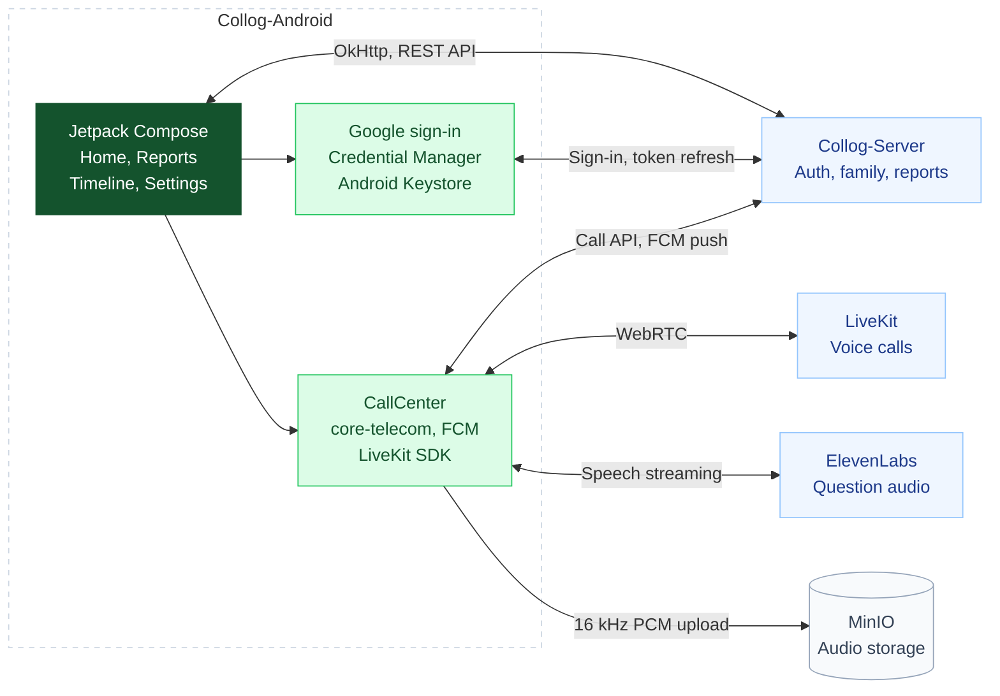

### 콜록 Android

[Collog-iOS](https://github.com/Collog-App/Collog-iOS)를 Kotlin(Jetpack Compose)으로 옮긴 안드로이드 앱입니다. 화면과 동작은 iOS와 같게 두었습니다. 옮기는 규칙은 [PORTING.md](PORTING.md)에 있습니다.



### iOS와 다른 점

- 로그인은 Apple 대신 Google입니다. 같은 사람이 iOS와 Android로 각각 가입하면 계정이 따로 생깁니다.
- 걸려 온 전화는 CallKit·PushKit 대신 Android Telecom(core-telecom)과 FCM 데이터 메시지로 받습니다.
- 오늘의 질문은 iOS 온디바이스 모델(FoundationModels)에 대응하는 것이 없어 기본 질문 목록을 씁니다.

### Build

JDK 17과 Android SDK Platform 37이 필요합니다.

```bash
./gradlew installDebug                                            # 운영 서버(https://api.collog.live)
./gradlew installDebug -Pcollog.apiBaseUrl=http://10.0.2.2:8080   # 에뮬레이터에서 로컬 서버
./gradlew testDebugUnitTest
```

Google 로그인과 FCM은 Firebase 설정 파일 `app/google-services.json`을 씁니다. 이 파일은 저장소에 넣지 않습니다. 파일 없이도 빌드와 체험 모드는 되지만, 전화 수신(FCM)은 동작하지 않습니다. Google 로그인만 켜려면 `-Pcollog.googleWebClientId=<웹 클라이언트 ID>`를 붙입니다.

서버의 Google 로그인(`/v1/auth/google`)과 FCM 발송은 아직 Collog-Server `main`에 들어가지 않았습니다.

<br />
<sub>
© 2026 Team Raichu of LIKELION SeoulTech. All rights reserved.
</sub>
